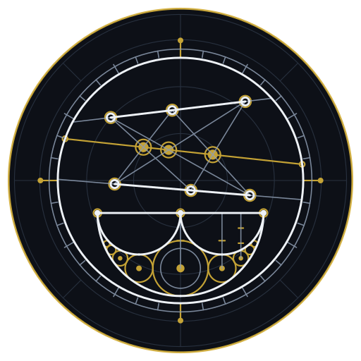

.. container:: author-overline

   semantic digital archive • the works of

====================
Pappus of Alexandria
====================

:person:`Pappus of Alexandria <pappus>` (fl. c. 320–340 CE) stood at the twilight of ancient Greek mathematics and gathered its greatest analytical treasures into his eight-book *Synagoge*. This archive unites a bilingual critical edition of Books III, IV, V, VII, and VIII with exact symbolic models in SymPy and ``geometor.model`` exploring Pappus's Hexagon Theorem, harmonic conjugates, and Pascal's *Hexagrammum Mysticum*.

Works in This Archive
---------------------

.. container:: home-book-hero

   .. container:: home-book-thumb

      .. image:: _static/constructions/pappus_arbelos_chain.svg
         :alt: Pappus's ancient theorem on the arbelos circle chain
         :target: synagoge/index.html

   .. container:: home-book-body

      .. rubric:: Bilingual Critical Edition · Books III, IV, V, VII & VIII · 35 Atomic Units

      **Mathematical Collection (*Μαθηματικὴ Συναγωγή*)** — Surveys classical geometry and mechanics from Friedrich Hultsch's Greek text and Federico Commandino's Latin edition: semicircle means, the *arbelos* circle chain, honeycomb isoperimetry, the Hellenistic *Treasury of Analysis*, and architectonic mechanics.

      .. container:: home-actions

         * :doc:`Open the Synagoge → <synagoge/index>`
         * :doc:`Book III (Means & Solids) → <synagoge/book_03/index>`
         * :doc:`Book VII (Treasury of Analysis) → <synagoge/book_07/index>`

.. container:: home-book-hero

   .. container:: home-book-thumb

      .. image:: _static/constructions/golden_pappus.svg
         :alt: Golden Ratio projectivity in Pappus's Hexagon over Q(phi)
         :target: theorems/index.html

   .. container:: home-book-body

      .. rubric:: Exact Symbolic Catalog · SymPy & geometor.model · 24 Vector Plates

      **Constructive Projective & Classical Theorems** — Executable exact-algebra investigations of Pappus's Hexagon Theorem, Jakob Steiner's six-line configuration, cross-ratio invariance, complete-quadrilateral harmonic conjugates, and Pascal's *Hexagrammum Mysticum*.

      .. container:: home-actions

         * :doc:`Explore Theorems → <theorems/index>`
         * :doc:`Hexagon Theorem → <theorems/hexagon-theorem/index>`
         * :doc:`Cross-Ratios & Harmonics → <theorems/cross-ratios-harmonics/index>`

Key Features
------------

.. container:: home-feature-grid

   .. container:: home-feature-card

      **Four-Track Bilingual Codex**

      Read Books III, IV, V, VII, and VIII across synchronized **English**, Hultsch polytonic **Greek**, analytical **Summary**, and primary-source **Notes** tracks.

   .. container:: home-feature-card

      **100% Exact Symbolic Projectivity**

      Every incidence, cross-ratio, and conic theorem in ``geometor.pappus`` is verified symbolically over :math:`\mathbb{Q}` and :math:`\mathbb{Q}(\phi)` with zero floating-point approximation.

   .. container:: home-feature-card

      **24 Calibrated Construction Plates**

      Interactive SVG diagrams illustrate all six :math:`S_3` Pappus lines, Steiner concurrency points, Pascal's 60-line web, semicircle means, and the rational *arbelos* chain.

Reference & Project
-------------------

.. container:: home-columns

   .. container:: home-col

      .. rubric:: Scholarly Apparatus

      * :doc:`People <synagoge/people/index>` — Pappus, Euclid, Apollonius, Archimedes, Hultsch, Commandino, Steiner, and Pascal
      * :doc:`Concordance <synagoge/concordance>` & :doc:`Bibliography <synagoge/bibliography>` — Hultsch–Commandino–folio mapping and critical editions
      * :doc:`Glossary <synagoge/glossary>` — Classical Greek analytic and projective terms

   .. container:: home-col

      .. rubric:: About This Project

      * :doc:`About <about/index>` — Scope, symbolic architecture, and connection to GEOMETOR
      * :doc:`Using This Edition <usage/index>` — Reading guide, track switching, and diagram controls
      * :doc:`Demos <demos/index>` — Interactive CLI demonstrations and constructive scripts

.. toctree::
   :hidden:
   :maxdepth: 2

   synagoge/index
   theorems/index
   usage/index
   demos/index
   about/index
